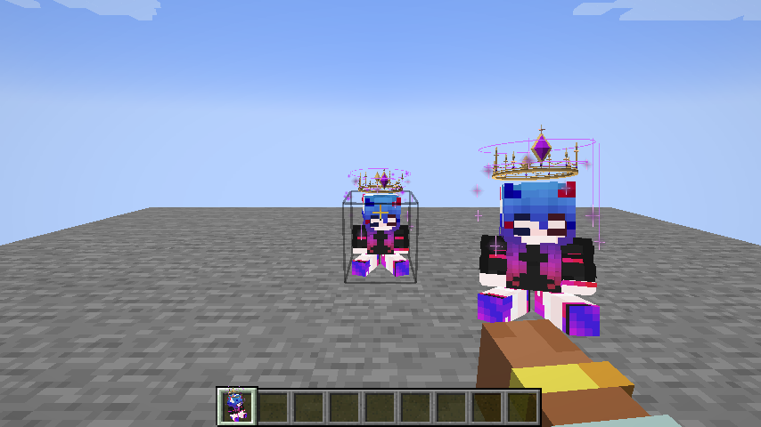
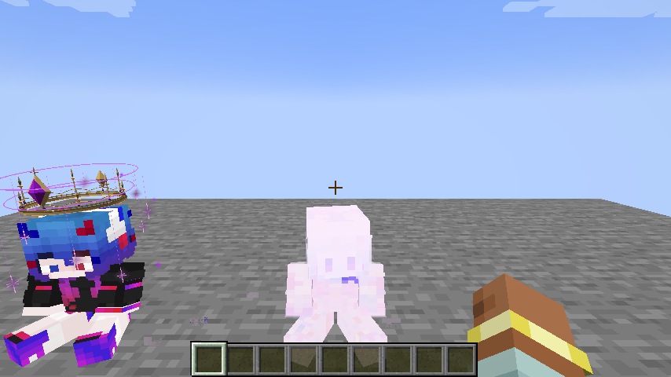
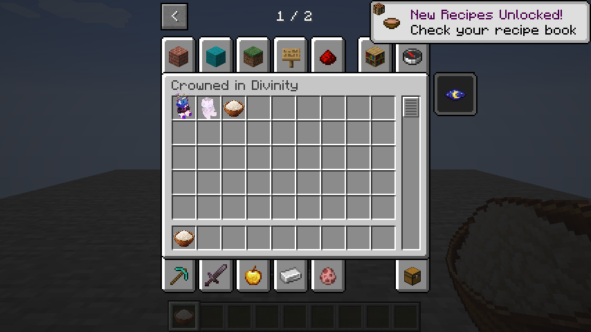
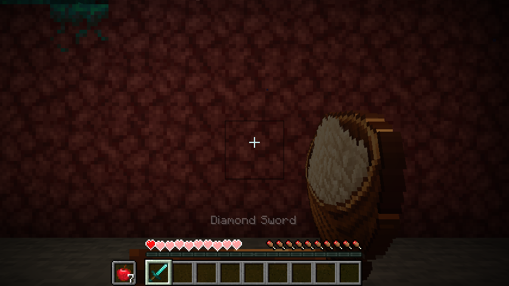
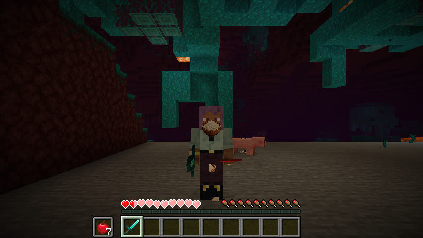

# 以神戴冠 1.12.0

Minecraft Java 1.20.1 · Forge 47.4.0+ · Java 17

包含成然玩偶、余乐玩偶与白饭的 Forge 模组，注册独立创造物品栏「以神戴冠」。客户端与服务器需要安装相同版本。

## 玩偶

- **成然玩偶**：至高神性，带圆形金色王冠、紫色星轨与下落星点；佩戴后启用生命保护、创造飞行、夜视、负面效果清除、防击退与附近生物 AI 暂停等能力。保护不保证覆盖任意 JVM 内存修改或所有第三方实现。
- **余乐玩偶**：摸鱼神性，独立皮肤与音乐，没有王冠、圆环或星点；保留外观及互动功能，未复制成然的战斗能力。
- 共享坐姿、托举手持、缩小头戴、动态眨眼、摇头和玩家跳跃时举臂。按住 Shift 展开说明。
- 对空气右键佩戴（头部装备槽需为空），对方块右键放置。右键已放置玩偶切换循环音乐，再次右键或破坏关闭。
- 音乐使 16 格球形范围内生物定身、上下抖动并旋转，关闭后解除。玩家可以自由移动、交互及关音乐。

## 余乐白饭宴

余乐玩偶播放音乐时，16 格范围内存活且非旁观的生物和玩家每 32 个服务器 tick（正常速度下 1.6 秒）吃一份白饭，获得原版**瞬间治疗 XXIX（29 级，amplifier=28）**。包含嘴前白饭晃动、米粒与咀嚼音效。

音乐提供虚拟食物，不替换、消耗或丢弃玩家和生物原本的装备，也不产生可拾取的白饭或空碗。关闭音乐、破坏玩偶、离开范围或卸载来源区块后停止；多个余乐玩偶的覆盖不会叠加进食速度。成然玩偶音乐不触发白饭宴。

白饭也可独立使用：右键正常进食，饱食时可吃，生存模式吃完返还空碗。

## 截图

以下为游戏实机截图。展示玩偶外观的部分截图来自此前版本；白饭宴截图来自 1.12.0。

### 成然玩偶


### 余乐玩偶


### 独立创造分类


### 白饭宴



## 构建

安装 JDK 17，在项目根目录通过 Windows PowerShell 执行：

```powershell
.\gradlew.bat build
```

首次构建需要联网下载 Gradle、Forge 及 Minecraft 开发依赖。输出位于 `build/libs/YiShenDaiGuan-1.20.1-1.12.0.jar`。

开发客户端：`.\gradlew.bat runClient`。独立验收附加模组源码位于 `tools/qa`，不包含在正式模组 JAR 中。

## 获取物品

```mcfunction
/give @s starcrowndoll:doll
/give @s starcrowndoll:yule_doll
/give @s starcrowndoll:white_rice
```

成然装备锁定：`/yishen lock`；解锁：`/yishen unlock`。

## 资源

皮肤与歌曲为项目所使用的用户提供素材；源码上传不改变这些素材原有的权利归属。模组元数据沿用 All Rights Reserved。
